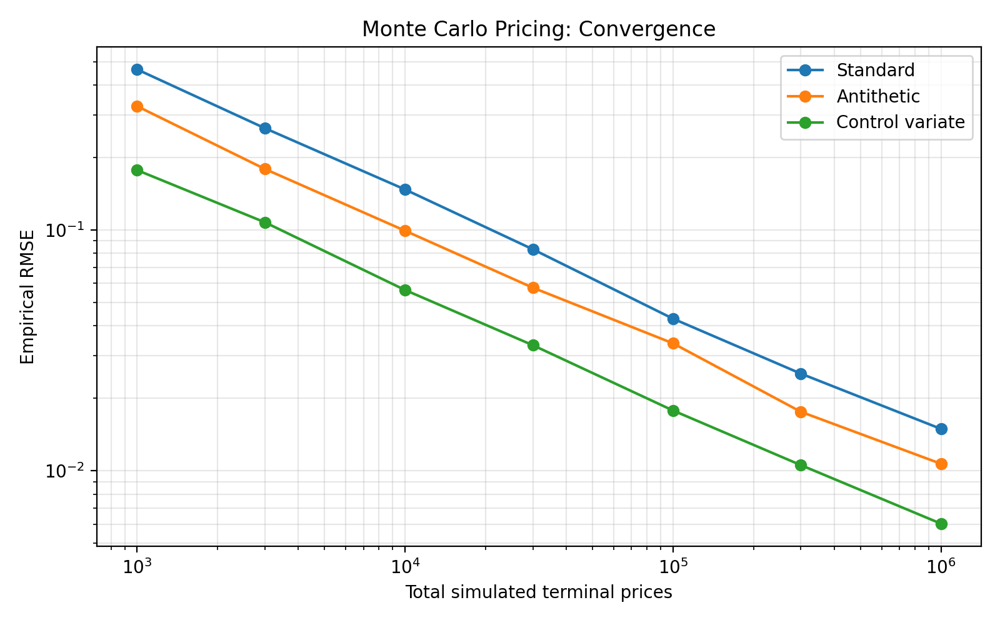
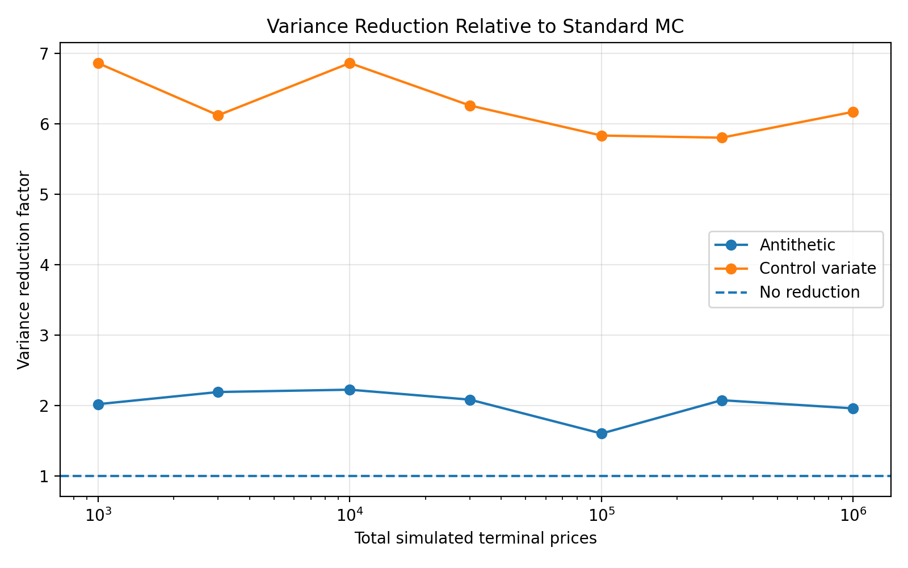
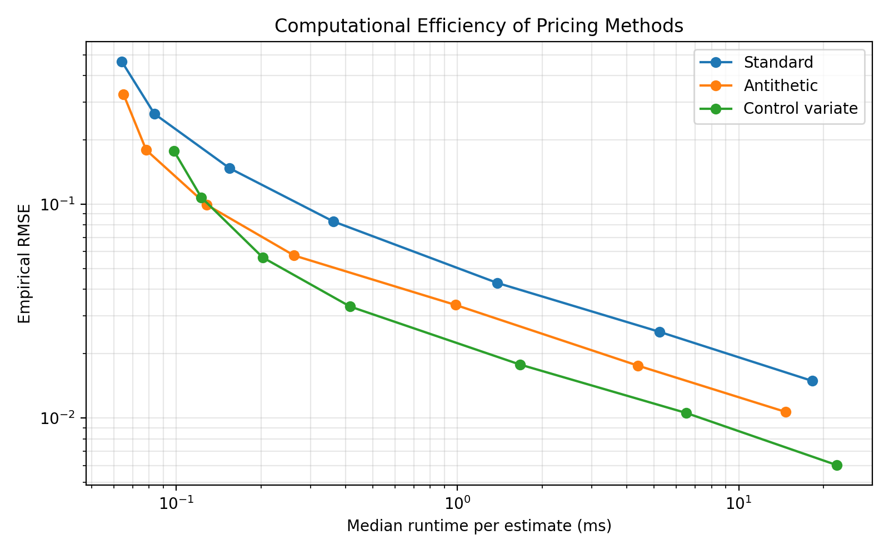

# Monte Carlo Options Pricing Engine

A Python implementation of Monte Carlo option pricing under the Black–Scholes model, with variance reduction, numerical validation and performance optimisation.

The project investigates the trade-off between statistical accuracy and computational cost, using NumPy, SciPy and Numba.

## Features

- **European option pricing:** Analytical Black–Scholes pricing and Monte Carlo simulation.
- **Asian option pricing:** Arithmetic-average and geometric-average Asian options.
- **Variance reduction:** Antithetic variates and control variates.
- **Statistical analysis:** Standard errors, 95% confidence intervals and convergence experiments.
- **Performance optimisation:** Numba compilation, parallel execution and chunked simulation.
- **Automated testing:** Tests covering pricing methods, numerical accuracy and optimisation routines.

## Mathematical Framework

Under the risk-neutral Black–Scholes model,

$$
dS_t=rS_t\,dt+\sigma S_t\,dW_t,
$$

where $r$ is the risk-free rate, $\sigma$ is volatility and $W_t$ is Brownian motion.

The terminal asset price is

$$
S_T=S_0\exp\left[\left(r-\frac{\sigma^2}{2}\right)T+\sigma\sqrt{T}Z\right],
\qquad Z\sim N(0,1).
$$

For a European call with strike $K$ and maturity $T$,

$$
C_0=e^{-rT}\mathbb{E}^{\mathbb{Q}}[(S_T-K)^+].
$$

The Monte Carlo estimator is

$$
\widehat C_N=\frac{e^{-rT}}{N}\sum_{i=1}^N(S_T^{(i)}-K)^+.
$$

The implementation estimates the standard error from simulated discounted payoffs and constructs approximate 95% confidence intervals.

## Variance Reduction

### Antithetic Variates

Normal random variables are generated in pairs, $Z$ and $-Z$. The corresponding payoffs are averaged to reduce sampling variance when the paired observations are negatively correlated.

### Control Variates

A correlated random variable with a known expectation is used to reduce estimator variance.

The project implements control variates for European calls and uses a geometric-average Asian option as a control for arithmetic-average Asian option pricing.

## Installation

Clone the repository:

```bash
git clone https://github.com/johnmvv/monte-carlo-options-pricing.git
cd monte-carlo-options-pricing
```

Install the dependencies:

```bash
python -m pip install -r requirements.txt
```

## Usage

Run a standard Monte Carlo simulation:

```bash
python monte_carlo.py
```

Compare with the analytical Black–Scholes solution:

```bash
python black_scholes.py
```

Example using the Python functions:

```python
from black_scholes import black_scholes_call
from monte_carlo import monte_carlo_call

params = dict(
    S0=100,
    K=100,
    T=1,
    r=0.05,
    sigma=0.2
)

exact = black_scholes_call(**params)

price, se, ci = monte_carlo_call(
    **params,
    n_simulations=100_000,
    seed=42
)

print(f"Analytical price: {exact:.4f}")
print(f"Monte Carlo price: {price:.4f}")
print(f"95% confidence interval: {ci}")
```

For these parameters, the analytical European call price is approximately **10.4506**.

Additional experiments:

```bash
python compare_methods.py
python compare_asian_methods.py
python compare_variance.py
python optimisation_suite.py --quick
```

Run the larger optimisation benchmark:

```bash
python optimisation_suite.py --full
```

## Performance Optimisation

The project compares NumPy implementations with serial and parallel Numba kernels.

### Parallel Kernel Benchmark

The following results were recorded using two million simulated paths and pre-generated normal random variables.

| Threads | Median runtime |
|---|---:|
| 1 | 8.116 ms |
| 2 | 4.011 ms |
| 4 | 3.420 ms |
| 6 | 2.457 ms |
| 12 | 1.790 ms |

The 12-thread kernel achieved approximately **4.5× speedup** relative to the single-thread implementation.

However, this improvement applies only to the computational kernel.

### End-to-End Performance

When random-number generation and chunk processing are included, parallel execution does not consistently improve runtime.

For example, using a chunk size of 100,000 paths:

| Configuration | Median runtime |
|---|---:|
| 1 thread | 20.28 ms |
| 12 threads | 21.00 ms |

This illustrates the importance of benchmarking the complete computational pipeline rather than individual kernels alone.

Results depend on hardware, thread configuration and simulation settings.

The saved benchmark was recorded on Windows 11 using Python 3.14.0 and NumPy 2.3.4.

Full results and experimental metadata are available in `results/optimisation/`.

## Numerical Results

The repository includes plots examining Monte Carlo convergence, variance reduction and computational efficiency.

### Convergence



### Variance Reduction



### Runtime and Accuracy



## Testing

The project includes automated tests covering analytical pricing, Monte Carlo estimators, Asian options, variance reduction and optimised implementations.

Run the tests with:

```bash
python -m pytest -q
```

The reviewed repository passed **60 automated tests**.

Tests check the implemented cases but do not establish correctness for every possible parameter combination.

## Project Structure

| File or directory | Purpose |
|---|---|
| `black_scholes.py` | Analytical European call pricing |
| `monte_carlo.py` | Standard Monte Carlo pricing |
| `antithetic.py` | Antithetic variates |
| `control_variate.py` | European option control variates |
| `asian_options.py` | Arithmetic Asian option pricing |
| `geometric_asian.py` | Geometric Asian option pricing |
| `asian_control_variate.py` | Asian option control variates |
| `numba_asian.py` | Numba-optimised Asian simulation |
| `optimised/` | Optimised and parallel pricing implementations |
| `optimisation_suite.py` | Performance and numerical benchmarking |
| `benchmark*.py` | Additional benchmarking experiments |
| `compare*.py` | Pricing method comparisons |
| `plot_results.py` | Results visualisation |
| `tests/` | Automated tests |
| `results/` | Saved figures and benchmark data |

## Limitations

The Black–Scholes model assumes geometric Brownian motion, constant volatility, constant interest rates and frictionless markets.

The implementation does not account for volatility smiles, jumps or transaction costs.

Monte Carlo estimates have sampling uncertainty. Confidence intervals rely on statistical approximations, and computational performance depends on the execution environment.

The project is intended for mathematical and computational research, not production trading.

## Licence

Released under the MIT Licence. See [LICENSE](LICENSE).
